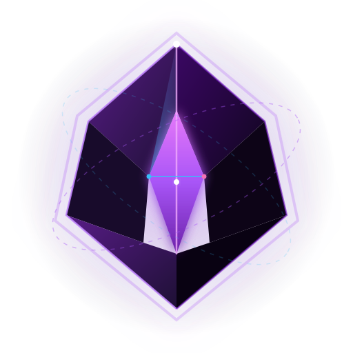
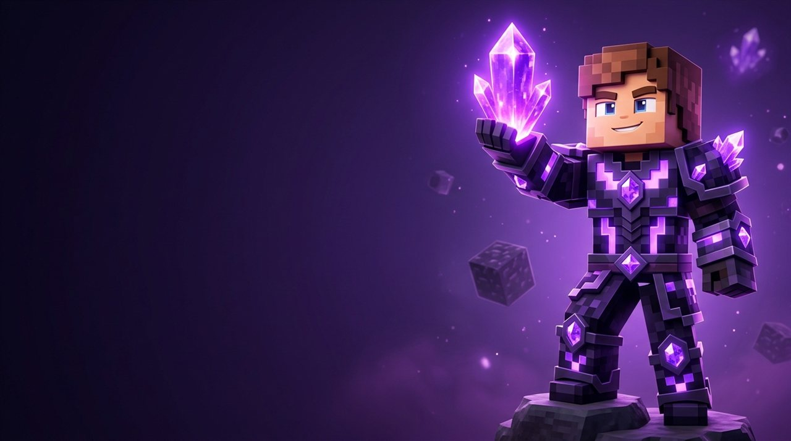
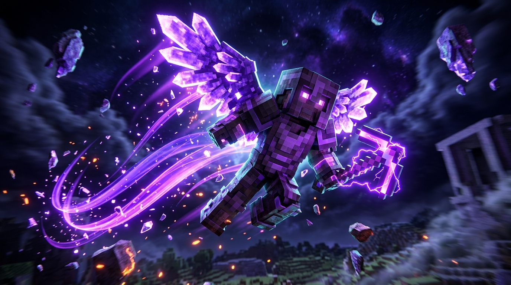
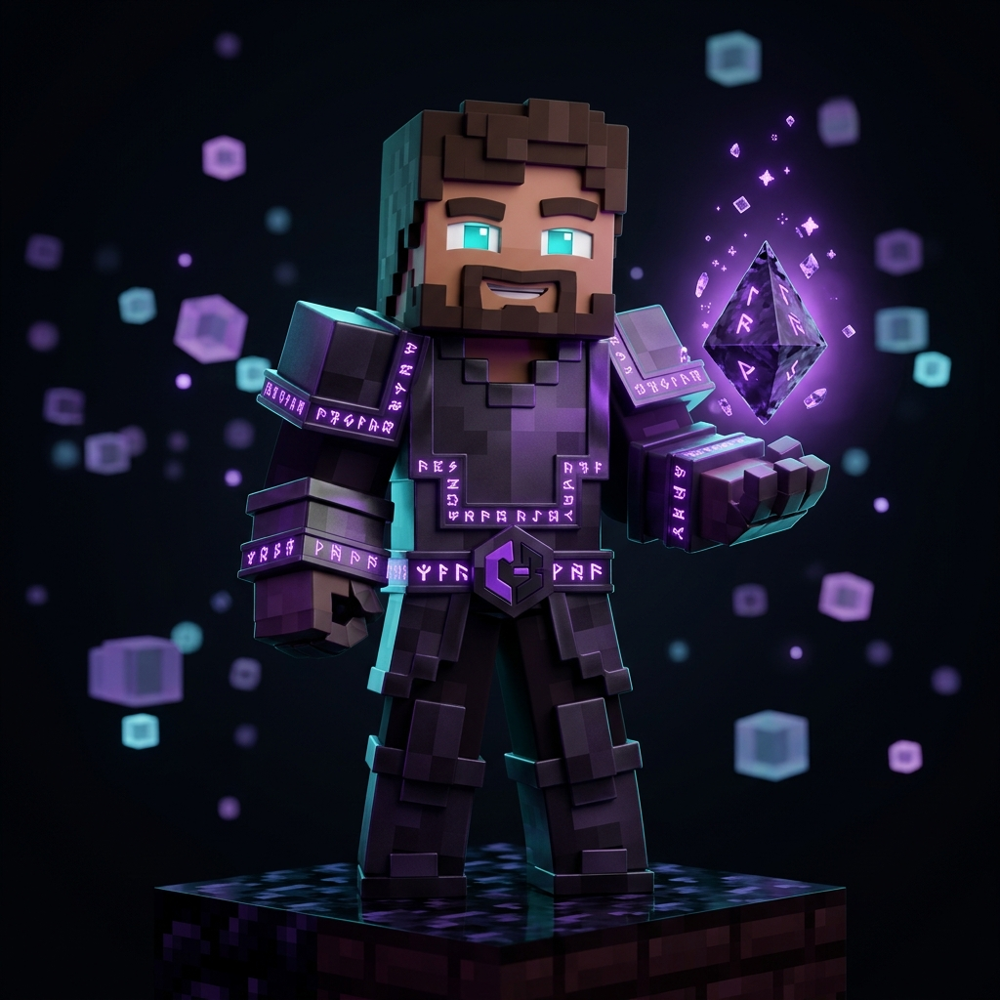
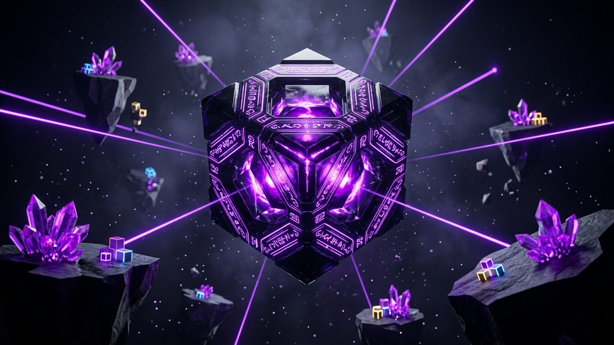

  
  <h1>Obsidian LLC</h1>
  

    <strong>Инженерная экосистема нового поколения для Minecraft: высокопроизводительные лаунчеры, игровые серверы и инфраструктурные решения.</strong>
  

  

    
    
    
  

   

  

---

## 🌌 О компании

**Obsidian LLC** — технологическая организация и команда разработчиков, создающая программные продукты и игровые пространства нового поколения. Мы переосмысляем пользовательский опыт в индустрии Minecraft, отказываясь от перегруженных, медленных и устаревших решений в пользу скорости, эстетики и инженерной точности.

Наша цель — объединить **современные клиентские приложения**, **стабильную серверную инфраструктуру** и **удобные инструменты для игроков и разработчиков** в единую бесшовную экосистему.

---

## 🚀 Ключевые направления разработки

<table>
  <tr>
    <td width="50%" valign="top">
      <h3>🔮 Лаунчеры нового поколения</h3>
      

        Флагманский продукт — <strong>Obsidian Launcher</strong>. Быстрый, минималистичный и умный клиент без рекламы и фонового потребления ресурсов.
      

      <ul>
        <li><strong>Агрессивный Game Mode:</strong> выгрузка UI из ОЗУ во время игры.</li>
        <li><strong>Умная работа с железом:</strong> автоприоритет дискретных видеокарт и пресеты <em>FPS Boost</em>.</li>
        <li><strong>Экосистема модов:</strong> Drag & Drop импорт модпаков (<code>.mrpack</code>, CurseForge, Prism), каталог Modrinth и автообновление модов в 1 клик.</li>
        <li><strong>Диагностика и сеть:</strong> встроенный <em>Crash Analyzer</em>, автономный режим и игра с друзьями без сторонних VPN.</li>
      </ul>
    </td>
    <td width="50%" valign="top">
      <h3>⚔️ Игровые серверы и проекты</h3>
      

        Разработка и поддержка высоконагруженных игровых серверов с уникальными механиками, кастомными плагинами и глубокой оптимизацией ядра.
      

      <ul>
        <li><strong>Высокий TPS и стабильность:</strong> тонкая настройка серверных ядер и распределение нагрузки.</li>
        <li><strong>Собственные игровые режимы:</strong> продуманная экономика, кастомные сборки и регулярные сезонные обновления.</li>
        <li><strong>Бесшовная интеграция:</strong> прямая связка серверов с нашим лаунчером, системой скинов и авторизацией.</li>
      </ul>
    </td>
  </tr>
  <tr>
    <td width="50%" valign="top">
      <h3>🛠️ Инструменты и Open-Source</h3>
      

        Создаём вспомогательные утилиты, парсеры логов, API-обвязки и библиотеки для автоматизации работы с модификациями, ресурсами и сборками.
      

    </td>
    <td width="50%" valign="top">
      <h3>🎨 UI/UX и визуальный дизайн</h3>
      

        Особое внимание уделяем интерфейсам: тёмная эстетика, плавные анимации, интуитивная навигация и отсутствие визуального шума.
      

    </td>
  </tr>
</table>

---

## 🖼️ Визуальная вселенная Obsidian

  <table>
    <tr>
      <td align="center" width="33%">
        
         
        <b>Скорость и свобода</b> — оптимизация без компромиссов
      </td>
      <td align="center" width="33%">
        
         
        <b>Инженерное ядро</b> — надёжная архитектура
      </td>
      <td align="center" width="33%">
        
         
        <b>Игровые миры</b> — серверы нового поколения
      </td>
    </tr>
  </table>

---

## 💻 Технологический стек и принципы

* **Клиентская часть и десктоп:** C#, .NET, TypeScript, React, современный веб- и нативный UI
* **Серверная инфраструктура и бэкенд:** Go, Python, высокопроизводительные игровые ядра (Paper / Purpur / Velocity / Fabric / NeoForge)
* **Наши принципы:**
  1. **Zero Bloatware** — никакого лишнего мусора, майнеров и навязчивой рекламы.
  2. **Player-First UX** — сложные технические вещи (выбор GPU, сборка модов, анализ крашей) решаются в один клик.
  3. **Прозрачность и безопасность** — открытые чек-суммы релизов и бережное отношение к данным пользователей.

---

  
  <h3>Присоединяйтесь к комьюнити Obsidian</h3>
  
Следите за релизами, обновлениями серверов и девлогами в нашем официальном Telegram-канале.

  

